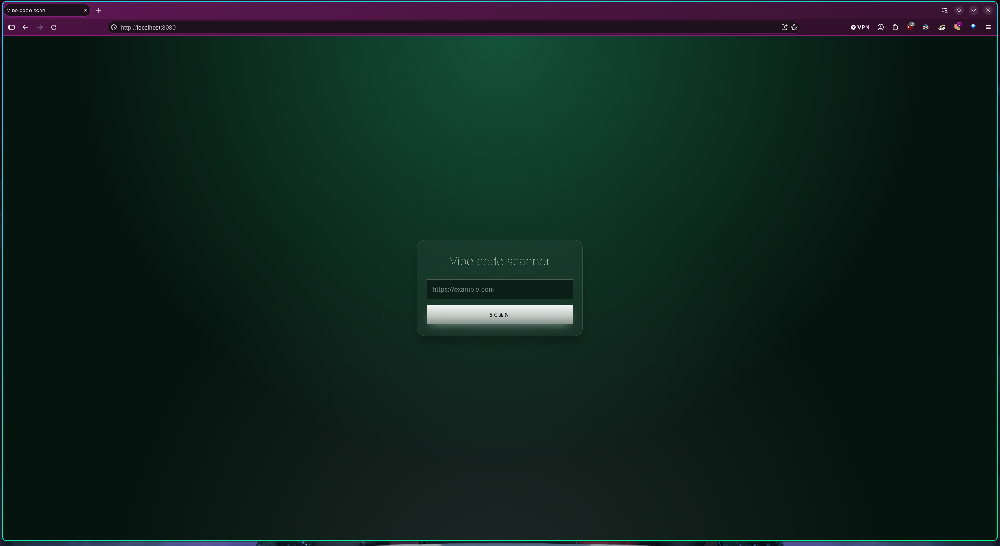
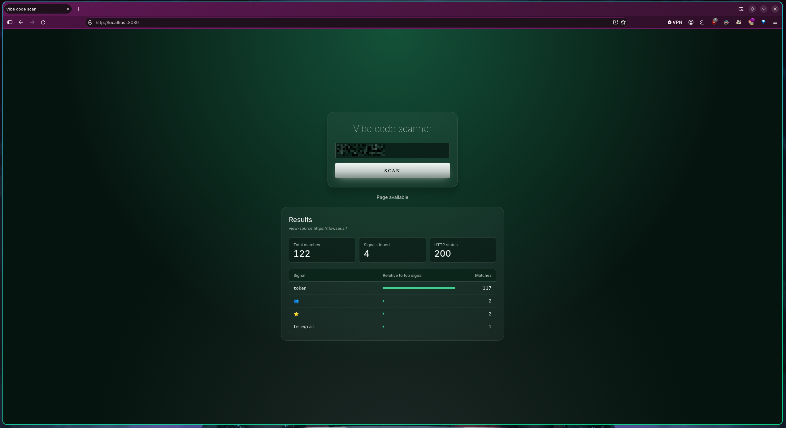

# Vibe coded detector

> A simply vibe code detector

**vcoded_detector** is a tool that analyzes websites for patterns and keywords associated with vibe-coded (AI-generated) code. Paste the link of any page: the tool downloads its source code, checks it against a list of patterns (`wordlist.txt`), and displays statistics in a web dashboard.



## Features

- Analyzes the source code of any public URL.
- Detects patterns and keywords defined in an editable wordlist.
- Simple web dashboard: just paste the link.
- Match statistics once the analysis finishes.

## How It Works

1. You enter a URL in the dashboard.
2. `crawler.py` fetches the page's source code.
3. The source is checked against the entries in `wordlist.txt`.
4. The dashboard displays the analysis statistics.

## Project Structure

| File | Description |
|---|---|
| `crawler.py` | Downloads the URL's source code and runs detection. |
| `dashboard.go` | Web server that serves the dashboard. |
| `Dashboard.html` | Main interface. |
| `script.js` | Frontend logic. |
| `styles.css` | Dashboard styles. |
| `wordlist.txt` | List of patterns and keywords to search for. |

## Requirements

- Python 3.[VERSION] or later
- Go [VERSION] or later
- [Python dependencies, if any, listed in `requirements.txt`]

## Installation

```bash
git clone https://github.com/AreiaNight/vcoded_detector.git
cd vcoded_detector
```

## Usage

### Running Locally

Start the dashboard server:

```bash
go run dashboard.go
```

Open in your browser:

```
http://localhost:8080
```

Paste the link of the page you want to analyze and review the stats.



### Customizing the Wordlist

Edit `wordlist.txt` to add or remove patterns, or change the path to the list directly in `crawler.py` or `dashboard.go`.

## Server Deployment

The recommended approach is to run the tool on a server so it stays available.

### 1. Prepare the Server

A Linux server (Ubuntu 22.04 or similar) with SSH access, and Go and Python 3 installed.

### 2. Clone and Build

```bash
git clone https://github.com/AreiaNight/vcoded_detector.git
cd vcoded_detector
go build -o vcoded_detector dashboard.go
```

### 3. Run as a Service (systemd)

Create the file `/etc/systemd/system/vcoded_detector.service`:

```ini
[Unit]
Description=vcoded_detector dashboard
After=network.target

[Service]
Type=simple
WorkingDirectory=/opt/vcoded_detector
ExecStart=/opt/vcoded_detector/vcoded_detector
Restart=always
User=www-data

[Install]
WantedBy=multi-user.target
```

Then enable the service:

```bash
sudo systemctl daemon-reload
sudo systemctl enable --now vcoded_detector
sudo systemctl status vcoded_detector
```

### 4. (Optional) Reverse Proxy with Nginx and HTTPS

```nginx
server {
    listen 80;
    server_name your-domain.com;

    location / {
        proxy_pass http://127.0.0.1:[PORT];
        proxy_set_header Host $host;
        proxy_set_header X-Real-IP $remote_addr;
    }
}
```

For HTTPS, you can use Certbot:

```bash
sudo certbot --nginx -d your-domain.com
```
